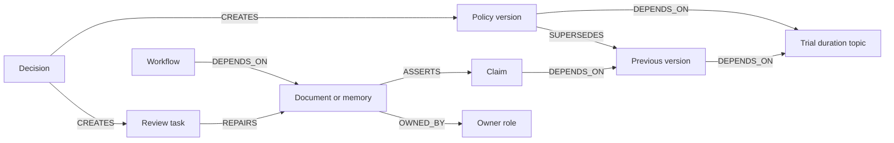

# Graph model

All domain nodes carry the `Entity` label, a stable `id`, a queryable `kind`, and a JSON `payload` holding the typed application record. Relationships are native graph edges, not relationships encoded only inside JSON. Their `active` property distinguishes current links from preserved historical links.

| Kind | Purpose | Important fields |
|---|---|---|
| policy | Shared topic or a policy version | value, scope, status, effectiveFrom, createdAt, revision |
| document | Source material inside Ripple | content, scope, ownerId, revision |
| workflow | A process dependent on source knowledge | content, scope, ownerId |
| memory | A saved agent answer | content, scope, revision |
| claim | A reviewed source assertion | value, scope, quote, sourceId, status |
| owner | Company policy owner, or fictional demo role | title |
| decision | Record of a policy change | policyId, status, effectiveFrom, scope |
| review | Work item created by analysis | artifactId, decisionId, path, original, proposed, sourceRevision, status |
| correction | Immutable record of a correction or owner review | artifactId, original, proposed, content, createdAt |
| research | Pending/approved public website snapshot | sourceUrl, content with pages/quotes/findings, createdAt, status |

The `topic-trial`, `topic-refund`, `topic-cancellation`, and `topic-support` nodes anchor separate policy neighborhoods across versions. This finds old, uncorrected knowledge after more than one policy update. The applicable policy is selected separately using topic, approval, audience, effective date and recorded version order. Records without an explicit topic retain their legacy trial-duration meaning. Corrections retire only assertions for the changed topic.

The map displays a selected neighborhood. Intermediate claims are collapsed visually, but the displayed connections are derived from active stored edges. An impact detail shows the full stored path.

## Applying a correction

1. Verify the review is pending, is a direct conflict, and contains a safe targeted proposal.
2. Recheck applicable policy and the source revision/content.
3. Preserve the old claim node and mark its `ASSERTS` edge inactive.
4. Update the source content and increment its revision.
5. Create the new current claim and link it to the applicable policy.
6. Mark the review applied and append a correction record containing before/after content.
7. Persist all entity/edge upserts in one write query. Never delete and reseed a live graph.

Correction records carry source IDs as queryable payload references; the `review → REPAIRS → artifact` path links the review to its source. This prototype does not add a separate graph edge for every payload reference.

Applied text corrections can be exported as Markdown or JSON. The export reads the applied review and matching audit record; it does not mutate the graph. It preserves the correction's before/after revision and content, even if the source later changes again. The owner must check the external source's current revision before publishing.

Each signed-in organization uses its own graph, selected only after server-side session/membership checks. Auth accounts, memberships and sessions use SQLite; company knowledge does not. Website research remains pending until explicitly approved, then creates ordinary versioned policies and document/claim edges. Researching a site does not make its statements authoritative by itself.
